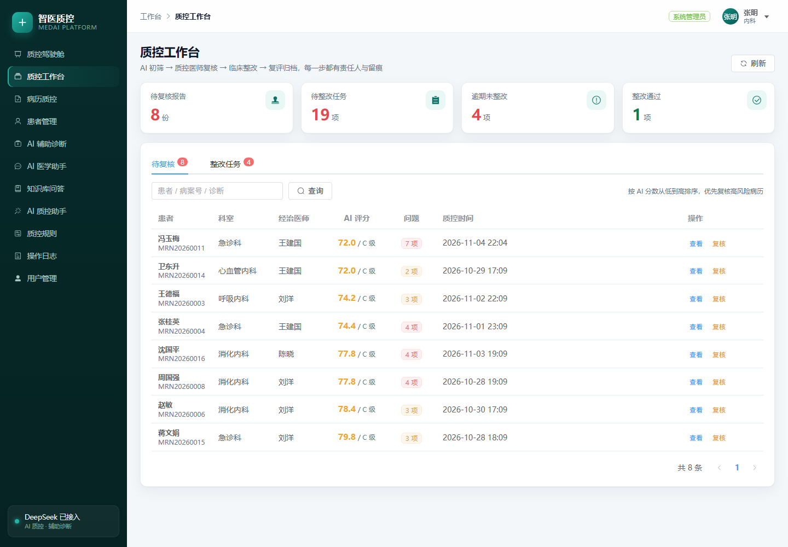
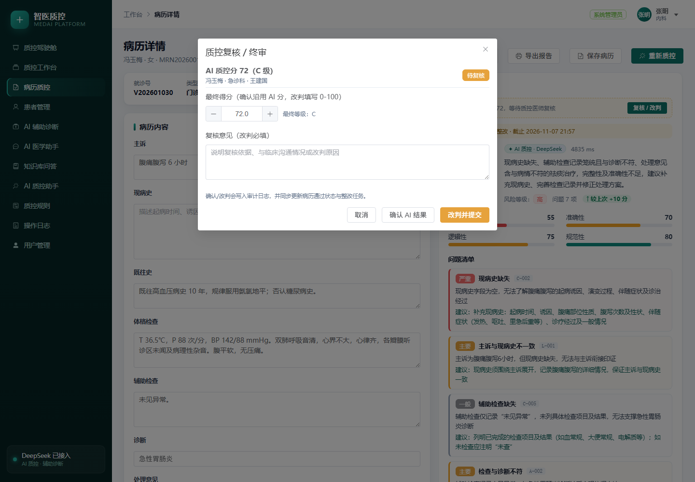
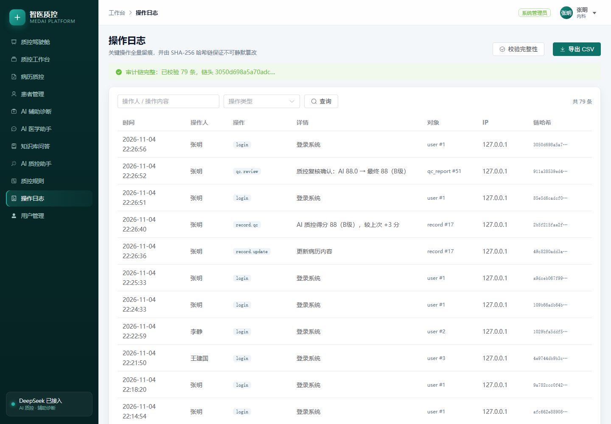
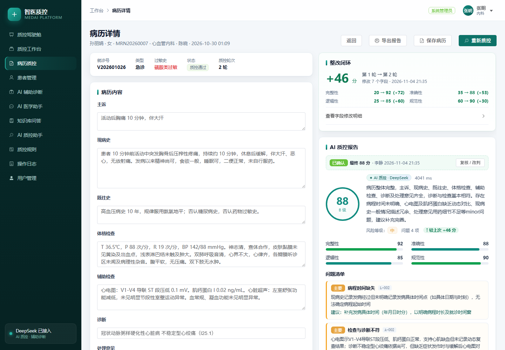
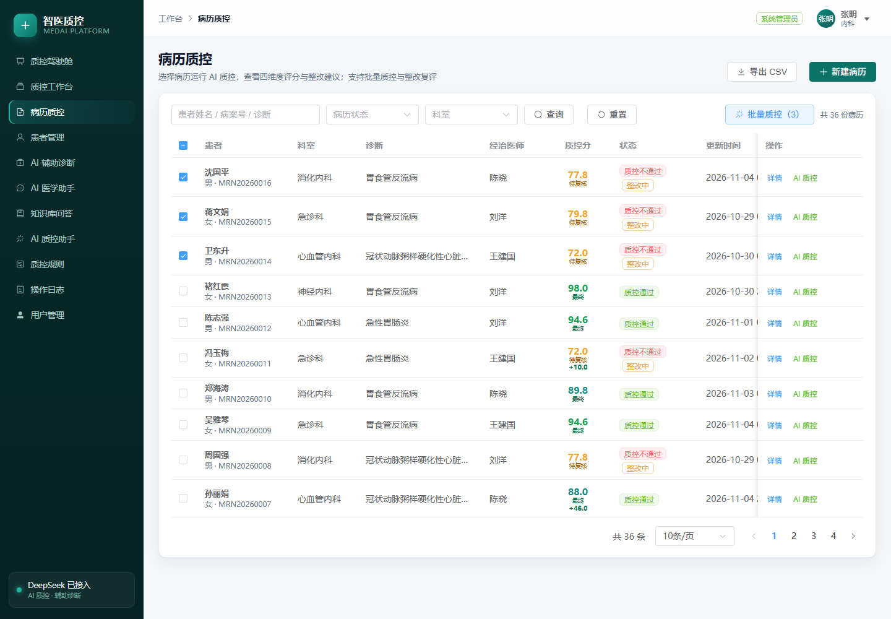
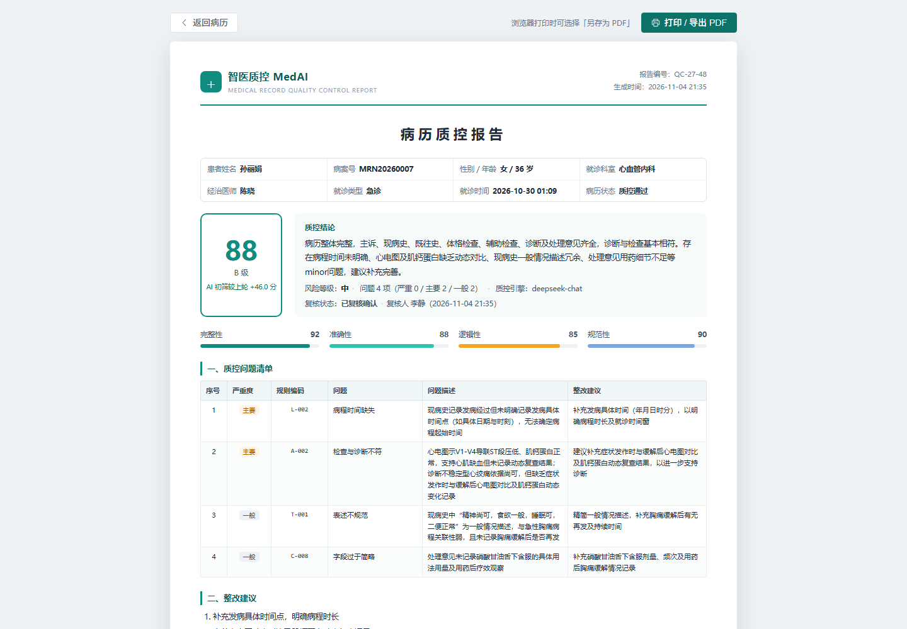
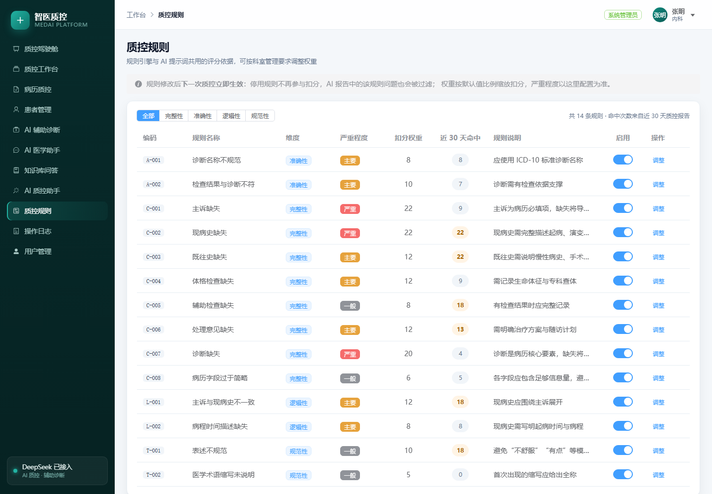

# 智医质控 MedAI · AI 病历质控与辅助诊疗平台

<p align="center">
  <a href="https://github.com/fengran-yx/medai/actions/workflows/ci.yml"></a>
  = 20">
  
  
  
  
</p>

> 面向医院病案质量的 AI 平台：自动识别病历缺项、逻辑矛盾、诊断与检查不符、术语不规范，给出四维度评分与整改建议；同时提供 AI 辅助诊断、医学问答、质控看板与审计留痕。

**技术栈**：Vue 3 + TypeScript + Vite + Element Plus + ECharts ｜ Node.js + Express ｜ MySQL 8.0 ｜ DeepSeek 大模型

**在线演示**（三个入口任选）：
- 🔗 **https://requirements-real-pendant-absent.trycloudflare.com**（HTTPS · Cloudflare）
- 🔗 **https://canola-kindness-scavenger.ngrok-free.dev**（HTTPS · ngrok，首次访问需点一下 Visit Site）
- 🔗 **http://47.119.38.7**（IP 直连，最快）

> 部署：阿里云 ECS · Ubuntu 22.04 · Nginx 反代 · systemd 常驻 · Cloudflare + ngrok 双通道
账号：`quality / qc123456`（质控医师）、`doctor / doc123456`（临床医师）、`admin / admin123`（管理员）

**状态**：核心功能可用 · CI 全绿（43 个后端单测 + 集成冒烟 + 前端构建）· 含人工复核、整改督办、审计哈希链与 36 份演示病历


| 病历质控 | AI 辅助诊断 |
| --- | --- |
|  |  |

| 病历详情 + AI 质控报告 | AI 医学助手 |
| --- | --- |
|  |  |

| 知识库问答（RAG） |
| --- |
|  |

| AI 质控助手（Agent） |
| --- |
|  |

| 质控工作台（待复核 / 整改督办） | 人工复核 / 终审 |
| --- | --- |
|  |  |

| 审计哈希链校验 | 质控整改闭环（版本对比） |
| --- | --- |
|  |  |

| 批量质控 | 质控报告导出（打印 / PDF） |
| --- | --- |
|  |  |

| 规则命中统计 |
| --- |
|  |

> 想按代码执行顺序逐步理解实现？看 **[docs/代码导读.md](docs/代码导读.md)**（从建表 SQL 到一次 AI 质控的完整链路）。
>
> 想了解整改闭环、批量质控与规则热生效？看 **[docs/质控闭环.md](docs/质控闭环.md)**。
>
> 想了解人工复核、整改督办、审计哈希链与医院部署清单？看 **[docs/医院落地.md](docs/医院落地.md)**。
>
> 想快速看效果？**[讲解版演示视频](docs/智医质控-MedAI-讲解版.mp4)**（3 分 12 秒，中文配音，走完登录→质控→诊断→问答全流程）；也有 [1 分 21 秒纯字幕版](docs/演示视频.mp4)。

---

## 一、5 分钟跑起来

### 0. 环境要求

| 依赖 | 版本 | 说明 |
| --- | --- | --- |
| Node.js | ≥ 20 | 已内置 npm |
| MySQL | 8.0 | 默认端口 3306 |
| 浏览器 | Chrome / Edge | — |

### 1. 配置数据库连接

编辑 `server/.env`，把 `DB_PASSWORD` 改成你自己的 MySQL root 密码：

```ini
DB_HOST=127.0.0.1
DB_PORT=3306
DB_USER=root
DB_PASSWORD=你的密码
DB_NAME=medai
```

### 2. 建库建表 + 写入演示数据

```bash
cd server
npm install
npm run db:init     # 创建 medai 库与 20 张表
npm run db:seed     # 写入 20 位患者、36 份病历、质控报告等演示数据
```

> 已有旧版数据库（升级代码但不想重建数据）时，执行 `npm run db:migrate`：
> 幂等补齐版本快照、批量质控、整改任务、复核字段、审计哈希链、登录锁定字段与新增规则，不会清空业务数据。
> 如清洗过审计日志，再执行 `npm run audit:rebuild` 重建哈希链。

### 3. 启动后端（端口 8801）

```bash
cd server
npm run dev
```

看到 `智医质控 MedAI 服务已启动` 即可，健康检查：<http://127.0.0.1:8801/api/health>

### 4. 启动前端（端口 5180）

```bash
cd web
npm install
npm run dev
```

打开 <http://127.0.0.1:5180> 登录。

### 演示账号

| 角色 | 账号 | 密码 | 可见功能 |
| --- | --- | --- | --- |
| 质控医师 | `quality` | `qc123456` | 全部质控功能、看板、规则调整、日志 |
| 临床医师 | `doctor` | `doc123456` | 仅本人病历、AI 辅助诊断、医学助手 |
| 系统管理员 | `admin` | `admin123` | 全部 + 用户管理 |

---

## 二、功能地图

| 模块 | 说明 |
| --- | --- |
| 质控驾驶舱 | 患者数、今日病历、30 天平均分、通过率、待处理、待复核、整改逾期；趋势图 / 科室分布 / 高频问题 / 最近质控 |
| 质控工作台 | 待复核队列（按 AI 分从低到高）+ 整改任务督办（状态 / 截止 / 逾期）+ 一键复核 |
| 人工复核与终审 | AI 只作初筛：质控医师可确认 AI 结果或人工改判，形成最终分并同步病历状态、整改任务 |
| 整改任务 | AI 不通过自动建单，带承办医师、科室、截止时间；复评通过自动关闭，质控科可人工关闭 |
| 审计防篡改 | 所有关键操作写入 SHA-256 哈希链，支持一键校验完整性、导出审计 CSV |
| 登录与会话安全 | 密码策略、连续失败锁定、管理员解锁、强制下线、改密后旧 token 失效 |
| 病历质控 | 病历列表（状态、科室、关键词筛选）→ 一键 / 批量 AI 质控 → 四维度评分 + 问题清单 + 整改建议；支持按筛选条件导出 CSV |
| 病历详情 | 结构化字段编辑（主诉 / 现病史 / 既往史 / 查体 / 辅助检查 / 诊断 / 处理意见），质控历史时间线，整改前后版本对比，复核面板 |
| 质控整改闭环 | 每次质控留档版本，复评自动计算分数提升、四维度变化与逐字段 diff，形成“质控 → 整改 → 复评”证据链 |
| 质控报告导出 | 独立打印页，浏览器「打印 / 另存为 PDF」即可交付，含最终分、复核状态、问题清单、整改建议与签名栏 |
| 患者管理 | 患者主索引、就诊档案抽屉、新增 / 编辑 |
| AI 辅助诊断 | 症状 + 检查 → 鉴别诊断（含 ICD-10）、建议检查、危险信号、分诊建议 |
| AI 医学助手 | 多会话问答，落库保存历史 |
| 知识库问答（RAG） | 病历书写规范 / 质控规则 / 核心制度 / 缺陷案例入库 → 混合检索 → 带引用回答 |
| AI 质控助手（Agent） | 自然语言下指令 → 模型自主规划 → 调用工具（查病历 / 跑质控 / 出统计）→ 汇总答复 |
| 质控规则 | 14 条规则，按完整性 / 准确性 / 逻辑性 / 规范性分类，可启停、调权重与严重度；修改后下一次质控立即生效，并展示近 30 天命中次数 |
| 操作日志 | 登录、质控、批量质控、建档、诊断、规则调整全留痕 |
| 用户管理 | 新增账号、改角色 / 科室、启停、重置密码 |

---

## 三、AI 能力：双引擎设计

```
                        ┌──────────────────────────┐
   病历 / 症状输入  ───▶ │  ai/index.js  统一入口    │
                        └───────────┬──────────────┘
                                    │
                    ┌───────────────┴───────────────┐
            配置了 DEEPSEEK_API_KEY          未配置 / 调用失败
                    │                               │
            DeepSeek Chat 补全                 本地规则引擎
        （JSON 模式，强制结构化输出）      （local.js，可解释、零成本、离线）
                    │                               │
                    └───────────────┬───────────────┘
                                    ▼
                    统一结构 { score, dimensions, issues, ... }
```

- **DeepSeek 模式**：在 `server/.env` 填入 `DEEPSEEK_API_KEY`，质控 / 诊断 / 问答全部走大模型，`response_format: json_object` 保证结构化，返回后仍用 `normalizeQC()` 做字段校验与钳制。
- **规则引擎模式**：默认模式，无需 Key 即可完整演示。按「完整性 40% + 准确性 30% + 逻辑性 20% + 规范性 10%」加权，再对严重问题额外扣分并设置分数上限（例如出现必填项缺失，分数封顶 72 分）。
- **自动降级**：大模型超时（45s）、报错、返回非 JSON 时，自动回退规则引擎，前端会标注 `rule-engine(fallback)`。

---

## 三·五、RAG 知识库设计

`server/src/kb/` 实现了一条不依赖外部向量服务的检索增强链路：

```
文档 → 按【小节】切块 → 单字+双字分词 → 稀疏向量入库
问题 → 同套分词 → BM25 + TF-IDF 余弦混合打分 → TopK 片段
     → 拼进提示词 → 大模型归纳（带 [1][2] 引用）
     → 无 Key / 调用失败时降级为抽取式回答
```

**为什么这么设计（面试可讲）**

| 决策 | 理由 |
| --- | --- |
| 分词用「单字 + 相邻双字」 | 不引 jieba/词典，医学双字词（肺炎、心绞痛、现病史）召回足够，零依赖、可离线 |
| 切块按 `【小节】` 强制断开 | 一个块只讲一个主题，避免「主诉 + 现病史 + 查体」混在一起稀释权重；上限 260 字、重叠 60 字 |
| BM25 与余弦加权 0.65 / 0.35 | BM25 抓精确术语，余弦补偿同义改写；BM25 用 `x/(x+3)` 压到 0~1 再融合 |
| 标题命中加 0.25 以内权重 | 「主诉怎么写」这类问题，标题含关键词的文档才是正解 |
| 索引缓存用 `(行数, 最大id)` 做签名 | 数据变了自动重建，避免多进程/重新灌数据后读到旧索引 |
| 不用向量库 | 几百个分块的规模内存里算余弦足够；接口设计成可替换，上规模换 pgvector 即可 |

**效果（`GET /kb/search?q=主诉怎么写`）**

| 排名 | 命中文档 | 分数 |
| --- | --- | --- |
| 1 | 病历书写基本规范 · 【主诉】段 | 0.540 |
| 2 | 常见病历缺陷案例 · 主诉与现病史不一致 | 0.497 |
| 3 | 质控评分规则 · 【逻辑性】段 | 0.492 |

**引用与兜底**

- 回答里每个结论都带 `[1]` `[2]`，前端渲染成可点击的「引用来源」卡片；
- 没有配置 `DEEPSEEK_API_KEY` 时返回原文摘录 + 提示配置，**功能不缺失**；
- 每次问答写入 `kb_qa_logs`（问题、答案、引用、模型、耗时），为后续评测留数据。

**检索评测（42 条标注问题，`npm run eval:rag`）**

| 配置 | Recall@1 | Recall@3 | MRR |
| --- | ---: | ---: | ---: |
| 基线（BM25 + 余弦） | 88.1% | 97.6% | 0.921 |
| + 同义扩展 | 81.0% | 97.6% | 0.873 |
| + 词覆盖重排 | 85.7% | 97.6% | 0.913 |
| **+ 扩展 + 重排（线上默认）** | **88.1%** | **100%** | **0.929** |

有意思的是：**同义扩展单独用会拉低 Recall@1**（召回变宽、噪声变多），但它把候选池撑大之后，再配合「原始问题词覆盖重排」，Recall@3 反而从 97.6% 提到 100%。这条链路展示的不是"调参玄学"，而是先量化、再取舍。

CI 里这一步设了门槛：`Recall@3 < 90%` 直接让流水线失败，防止后续改动悄悄劣化检索。

**大模型链路真实验证（DeepSeek 线上调用）**

不是「写了没跑过」——用真实 Key 跑通后记录的数据：

| 能力 | 模型 | 耗时 | 结果 |
| --- | --- | ---: | --- |
| 病历质控 | deepseek-chat | 4.2s | 52 分 / C 级 / 6 条问题，能指出「诊断肺炎但处理意见无抗感染治疗」这类逻辑矛盾 |
| 辅助诊断 | deepseek-chat | 2.4s | 急性支气管炎为首选，附依据 |
| RAG 问答 | deepseek-chat | 1.6s | 3 处引用，回答带 `[1]` 标注 |
| 医学问答 | deepseek-chat | 3.8s | 四维度结构化回答 |

另外新增 **7 个大模型契约测试**（`server/test/llm-contract.test.mjs`）：用本地 mock 的 OpenAI 兼容服务验证请求体（`response_format`、Bearer 令牌）、代码块包裹的 JSON 解析、缺字段兜底、分数钳制、500 降级、非 JSON 降级、RAG 上下文拼接。**无需真实 Key 即可在 CI 跑**。

---

## 三·六、Agent 设计（工具调用）

`server/src/agent/` 是一个带工具调用的最小 Agent，不是「把问题丢给模型」的伪 Agent。

**三个工具（都做了参数约束）**

| 工具 | 作用 | 约束 |
| --- | --- | --- |
| `query_records` | 按状态 / 关键词查病历 | `limit` 上限 20，避免全表扫描 |
| `run_qc` | 对单条病历跑 AI 质控并落库 | 一次一条，防止模型批量误伤 |
| `qc_statistics` | 近 N 天质控统计（份数 / 均分 / 通过率 / 高频问题 / 科室分布） | `days` 上限 90 |

**大模型模式（function calling 循环）**

```
用户目标 → 模型判断 → tool_calls → 执行 → 结果回灌 role:"tool"
        → 模型继续判断 …（最多 5 轮）→ 最终答复
```

**规则模式（无 Key / 调用失败）**：按目标关键词选固定编排（批量 → 查病历 + 逐条质控；周报 → 统计），同样产出完整步骤与答复——保证演示和 CI 不依赖外部服务。

**实测一次运行**（目标：把最近质控不通过的病历重新质控，并给出本周质控周报）

| 步 | 工具 | 参数 | 耗时 |
| --- | --- | --- | ---: |
| 1 | `query_records` | `{"status":"qc_failed","limit":20}` | 1 ms |
| 2 | `qc_statistics` | `{"days":7}` | 11 ms |
| 3 | `run_qc` | `{"recordId":27}` → 42 分 D 级 | 3.1 s |
| 4 | `run_qc` | `{"recordId":31}` → 62 分 C 级 | 3.7 s |
| 5 | `run_qc` | `{"recordId":17}` → 52 分 D 级 | 4.7 s |

总计 19 秒，模型自己决定「先查、再统计、再挑最低分的三条重做」，并输出带表格的周报。运行记录写入 `agent_runs`，前端可回放每一步。

---

## 三·七、质控整改闭环与批量质控

### 1. 为什么要做「版本」而不是只存报告

一份病历的质控价值不在单次得分，而在**改没改、改完有没有变好**。因此每次质控都会：

```
读取病历 → 运行 AI/规则引擎 → 写 qc_reports
        → 快照当前 7 个正文字段到 record_versions（版本号、四维得分、报告ID）
        → 与上一次得分比较，写入 prev_score / score_delta
```

医生按建议修改后重新质控，前端直接对比最近两个版本：

- **总分**：42 → 88，`+46`；
- **四维度**：完整性 20 → 72、逻辑性 25 → 80……
- **字段级 diff**：7 个字段的修改前 / 修改后全文对照；
- **问题追踪**：当前问题清单中，`field` 在 diff 里的会标记「本轮已修改」。

对应接口：`GET /records/:id/versions`、`GET /records/:id/versions/compare?from=1&to=2`。演示环境里孙丽娟（病历 27）就是一条完整链路：42 分 D → 补全现病史/查体/检查/诊断 → 88 分 B。

### 2. 批量质控为什么用任务表

20 份病历串行跑大模型会超过网关超时，所以做成**异步任务**：

```
POST /records/batch-qc { recordIds: [...] }
  → 建 qc_batches + qc_batch_items → 立即返回 batchId
  → 进程内并发 2 逐条执行，每完成一条更新 done/failed
前端每 1.5s 轮询 GET /records/batch-qc/:id
  → 进度条 + 每份病历的状态/分数/耗时/失败原因
```

约束与兜底：单次上限 20 份、同一病历已在队列中会跳过、临床医师只能操作本人病历、服务重启时把 `queued/running` 任务标记为失败并在启动日志提示，避免前端永远转圈。

### 3. 规则不是摆设：改完立即生效

`qc_rules` 里的启停 / 权重 / 严重度会真实进入评分：

- 规则引擎（`local.js`）按规则编码命中，**停用则不扣分、不出问题**；权重按 `当前权重 / 默认权重` 缩放扣分；
- 大模型返回的 `ruleCode` 先经 `matchRuleCode()` 做语义对齐（避免模型把“主诉与现病史不符”也套成 C-001），再按当前配置过滤与覆盖严重度；
- 规则页展示近 30 天每条规则的命中次数，管理端能判断“这条规则到底有没有用”。

规则缓存 10 秒，管理端保存后主动失效，下一次质控立即使用新配置。

### 4. 交付物：报告与清单

- **质控报告**：独立路由 `/records/:id/report`，A4 排版，浏览器打印即可「另存为 PDF」，含患者信息、评分、四维条形图、问题表、整改建议、质控留痕与签名栏；
- **病历清单**：`GET /records/export.csv`，带 UTF-8 BOM，Excel 直接打开不乱码；导出同样遵守临床医师的数据权限与当前筛选条件。

---

## 三·八、从演示到医院的治理补强

AI 质控进医院，难点不是“能不能打分”，而是**谁对结果负责、整改有没有人跟、日志能不能自证没被改、账号被盗能不能兜底**。这一版补了四件事。

### 1. AI 只是初筛，质控医师终审

- 每次质控报告默认 `review_status = pending`，`final_score = null`；
- 质控工作台按 AI 分从低到高排出待复核队列；
- 质控医师可「确认 AI 结果」或「人工改判」（填写 0-100 分与复核意见）；
- 最终分决定病历 `qc_passed / qc_failed`，并驱动整改任务；
- 只允许复核该病历**最新一次**报告，避免拿旧报告改当前状态；
- 每次复核/改判写入审计日志，报告打印页展示最终分、复核人、复核意见。

### 2. 整改任务必须有人、有截止时间

- AI 质控 <80 分自动建单：承办医师 = 病历经治医师，科室 = 就诊科室，默认 3 天截止（`RECTIFY_DUE_DAYS` 可配）；
- 复评 ≥80 分自动关闭；质控科也可人工关闭并留说明；
- 工作台按“逾期优先、截止时间升序”排序，看板显示待整改/逾期数；
- 同一病历不会重复建单，重新质控只更新关联报告。


### 3. 审计日志防篡改

- 每条审计日志：`hash = sha256(prev_hash + 规范化字段)`，写入 `audit_chain` 单行链头；
- 并发写入（批量质控 2 个 worker）通过 `SELECT ... FOR UPDATE` 串行化，不会写断链；
- `GET /logs/verify` 全量重算并比对链头，返回 `ok / checked / brokenId / reason`；
- 支持审计 CSV 导出；清洗历史数据后可用 `npm run audit:rebuild` 重建链。


### 4. 登录与会话安全

- 密码策略：8-64 位、必须字母+数字、不能包含登录名、常见弱口令拦截；
- 连续 5 次失败锁定 15 分钟（`LOGIN_MAX_ATTEMPTS` / `LOGIN_LOCK_MINUTES`），管理员可解锁；
- `users.token_version` 实现会话失效：改密/管理员重置/强制下线后，旧 token 立即 401；
- 操作日志与复核队列仅质控/管理员可见；临床医师仍只能看本人病历与本人整改任务。

> **必须说清楚**：代码层面这些是“可落地的治理骨架”，但真正进医院还需要 HIS/EMR 接口对接（HL7/FHIR 或视图库）、等保/数据安全评估、真实病历脱敏与 UAT、ICD/术语字典映射、临床专家对规则与阈值的签字确认、以及明确 AI 辅助不替代医师责任的制度文件。本项目不声称已满足任何合规认证。

---

## 四、目录结构

```
medai/
├── server/                     # 后端
│   ├── .env                    # 数据库 / JWT / DeepSeek 配置
│   ├── package.json
│   ├── sql/
│   │   └── schema.sql          # 20 张表的建表脚本
│   ├── scripts/
│   │   ├── init-db.js          # 建库建表
│   │   ├── migrate.js          # 旧库增量迁移（幂等，不丢数据）
│   │   └── seed.js             # 演示数据（bcrypt 密码、质控报告、日志）
│   └── src/
│       ├── index.js            # Express 入口、路由挂载、静态托管
│       ├── config.js           # 环境变量统一读取
│       ├── db.js               # mysql2 连接池 / query / transaction
│       ├── middleware/auth.js  # JWT 鉴权、角色校验、审计日志
│       ├── ai/
│       │   ├── index.js        # DeepSeek 调用 + 结构化校验 + 降级 + RAG 生成
│       │   └── local.js        # 规则引擎（质控 / 诊断 / 问答）
│       ├── qc/                 # 质控闭环
│       │   ├── service.js      # 单次质控统一入口（报告 + 状态 + 版本快照）
│       │   ├── versions.js     # 版本留档、字段级 diff、分数增量
│       │   ├── batch.js        # 批量质控任务队列 + 中断恢复
│       │   ├── rules.js        # 规则读取 / 缓存 / 命中统计
│       │   ├── rule-defs.js    # 默认规则、编码归一、AI 问题码语义对齐
│       │   └── csv.js          # CSV 转义与导出
│       ├── kb/                 # RAG 知识库
│       │   ├── tokenize.js     # 中文单字+双字分词、按【小节】切块
│       │   ├── search.js       # BM25 + TF-IDF 余弦混合检索
│       │   └── service.js      # 入库、索引缓存、问答、日志
│       └── routes/
│           ├── auth.js         # 登录、当前用户、改密码
│           ├── patients.js     # 患者 CRUD
│           ├── visits.js       # 就诊 + 科室字典
│           ├── records.js      # 病历 CRUD + 单条/批量质控 + 版本对比 + CSV 导出
│           ├── ai.js           # 辅助诊断、多轮问答、会话管理
│           ├── dashboard.js    # 看板聚合 + 整改闭环指标
│           └── admin.js        # 规则（含命中统计）、日志、用户
└── web/                        # 前端
    ├── vite.config.ts          # /api 代理到 8801
    └── src/
        ├── main.ts             # 挂载 Element Plus / Pinia / Router
        ├── api/http.ts         # axios 拦截器（token、401、错误提示）
        ├── api/index.ts        # 全部接口的类型化封装
        ├── stores/auth.ts      # 登录态
        ├── router/index.ts     # 路由 + 登录/角色守卫
        ├── layout/MainLayout.vue
        ├── components/QCPanel.vue   # 质控报告展示组件（含分差 / 已修改标记）
        └── views/              # 14 个页面（含质控工作台与报告打印页）
```

---

## 五、数据库设计（20 张表）

| 表 | 作用 | 关键点 |
| --- | --- | --- |
| `departments` | 科室字典 | 临床 / 医技 / 管理分类 |
| `users` | 用户 | bcrypt 密码、三种角色、登录锁定、token_version 会话失效 |
| `patients` | 患者主索引 | 病案号唯一、过敏史 |
| `visits` | 就诊记录 | 就诊流水号、就诊类型 |
| `medical_records` | 电子病历 | 7 个结构化字段 + 状态机 |
| `record_versions` | 质控版本快照 | 每次质控的正文快照、四维得分、报告ID，支撑整改 diff |
| `qc_rules` | 质控规则 | 维度 / 严重程度 / 权重 / 启停 |
| `qc_reports` | 质控报告 | AI 分、最终分、`review_status`、复核人、问题 JSON、分差 |
| `rectify_tasks` | 整改任务 | 承办医师 / 科室 / 截止时间 / 状态，支撑督办与逾期统计 |
| `qc_batches` | 批量质控任务 | 总数 / 完成 / 失败 / 平均提升 / 状态 |
| `qc_batch_items` | 批量质控明细 | 每份病历的状态、分数、报告ID、失败原因 |
| `diagnosis_sessions` | 辅助诊断记录 | 入参 + 结果 JSON |
| `ai_chats` / `ai_messages` | AI 会话与消息 | 多轮上下文 |
| `audit_logs` | 审计日志 | 操作人、动作、对象、IP、`prev_hash` / `hash` |
| `audit_chain` | 审计链头 | 单行链头，事务内 `FOR UPDATE` 串行写入 |
| `kb_documents` / `kb_chunks` | 知识库文档与分块 | 稀疏向量、小节切块 |
| `kb_qa_logs` | 知识库问答记录 | 问题 / 答案 / 引用 / 耗时 |
| `agent_runs` | Agent 运行记录 | 工具调用序列、最终答复，可回放 |

> 所有表 `ENGINE=InnoDB`、`utf8mb4`，外键约束齐全；`issues` 用 JSON 列存储，前端直接消费。

---

## 六、接口一览（前缀 `/api`）

| 方法 | 路径 | 说明 |
| --- | --- | --- |
| POST | `/auth/login` | 登录，返回 JWT |
| GET | `/auth/me` | 当前用户 |
| POST | `/auth/change-password` | 修改密码 |
| GET | `/patients` `?page&size&keyword` | 患者分页 |
| POST/PUT | `/patients` `/patients/:id` | 新增 / 更新 |
| GET | `/patients/:id` | 患者 + 就诊档案 |
| GET/POST | `/visits` | 就诊分页 / 新建 |
| GET | `/departments` | 科室字典 |
| GET/POST | `/records` | 病历分页 / 新建 |
| GET/PUT | `/records/:id` | 病历详情 / 保存 |
| POST | `/records/:id/qc` | **运行 AI 质控（返回分差与版本号）** |
| GET | `/records/:id/qc-history` | 质控历史（含 `prev_score` / `score_delta`） |
| POST | `/records/batch-qc` | **批量质控任务（异步，最多 20 份）** |
| GET | `/records/batch-qc/:id` | 批量任务进度 + 每份病历明细 |
| GET | `/records/:id/versions` | 质控版本列表 |
| GET | `/records/:id/versions/compare` | **整改前后字段级对比** |
| GET | `/records/export.csv` | 按当前筛选导出病历清单 CSV |
| POST | `/ai/diagnosis` | **AI 辅助诊断** |
| POST | `/kb/ask` | **知识库问答（检索 + 生成 + 引用）** |
| GET | `/kb/search?q&topK` | 只检索不生成（调试召回） |
| GET/POST | `/kb/documents` | 文档列表 / 入库（自动切块建索引） |
| DELETE | `/kb/documents/:id` | 删除文档及其分块 |
| GET | `/kb/stats` | 知识库统计 |
| POST | `/agent/run` | **Agent 执行目标（function calling）** |
| GET | `/agent/runs` `/agent/runs/:id` | 运行历史 / 回放 |
| GET | `/agent/tools` | 可用工具清单 |
| POST | `/ai/chat` | 多轮问答 |
| GET | `/ai/chats` `/ai/chats/:id/messages` | 会话列表 / 消息 |
| GET | `/dashboard/overview` `trends` `dept-distribution` `issue-categories` `recent-qc` | 看板 |
| GET | `/dashboard/rectification` | **整改闭环指标 + 待整改列表** |
| GET/PUT | `/rules` `/rules/:id` | 规则（修改后立即生效） |
| GET | `/rules/usage` | 近 30 天各规则命中次数 |
| GET | `/reviews/pending` | **待复核队列（仅质控/管理员）** |
| POST | `/reviews/:reportId` | **确认 / 改判质控报告** |
| GET | `/rectify-tasks` | **整改任务列表（含逾期计算）** |
| POST | `/rectify-tasks/:id/close` | 人工关闭整改任务 |
| GET | `/logs` | 审计日志（仅质控/管理员） |
| GET | `/logs/verify` | **校验审计哈希链完整性** |
| GET | `/logs/export.csv` | 导出审计日志 CSV |
| GET/POST/PUT | `/users` | 用户管理（仅 admin，支持解锁 / 强制下线） |

统一响应：`{ code: 0, data, message? }`，`code` 非 0 时前端拦截器自动提示。

---

## 七、在 Trae 中使用

1. Trae →「文件 → 打开文件夹」→ 选择 `F:\deepseek文件\medai`。
2. 根目录已内置 `.trae/rules/project-rules.md`，Trae 的 AI 会自动加载项目规范（命名、分层、SQL 习惯），后续让它改功能时风格不会跑偏。
3. 建议开两个终端（Trae 内置终端）：
   - 终端 A：`cd server && npm run dev`
   - 终端 B：`cd web && npm run dev`
4. 在 Trae 里选中代码右键「解释代码」，或直接在对话里说「给病历列表加一个按评分区间筛选」，它会基于项目上下文改。

---

## 八、生产部署要点

```bash
cd web && npm run build          # 产物 web/dist
cd server && npm start           # 自动托管 web/dist，单端口 8801
```

- 已有数据库升级：先 `cd server && npm run db:migrate`，再重启服务；
- 反代示例（Nginx）：`location / { proxy_pass http://127.0.0.1:8801; }`
- 必须修改：`JWT_SECRET`、数据库密码、`DEEPSEEK_API_KEY`
- 建议补充：HTTPS、登录失败次数限制、患者数据脱敏、数据库定期备份

---


## 九、安全与运维

| 项 | 状态 |
| --- | --- |
| SSH | 仅密钥登录，fail2ban 防爆破 |
| 防火墙 | ufw 仅放行 22/80/443 |
| 端口暴露 | 8801 / 3306 仅监听 127.0.0.1 |
| 登录限流 | 同 IP 15 分钟 10 次 |
| 账号锁定 | 连续 5 次失败锁定 15 分钟，管理员可解锁/强制下线 |
| 会话失效 | 改密、重置密码、强制下线后旧 token 立即失效（token_version） |
| 审计防篡改 | SHA-256 哈希链 + 全量校验 + CSV 导出；可用 `npm run audit:rebuild` 运维重建 |
| AI 责任边界 | AI 只作初筛，质控医师确认/改判后才形成最终分；报告标注复核人 |
| 权限边界 | 复核队列/审计日志仅质控与管理员；临床医师仅本人病历、本人患者与本人任务 |
| 数据范围 | 临床医师按 `doctor_id` 过滤病历/就诊/患者，直接猜 ID 访问他人病历返回 403；患者与就诊主数据仅质控/管理员可新建 |
| 自动更新 | unattended-upgrades 每日打补丁 |
| 备份 | 每日 03:30 自动备份，保留 14 天，已做恢复演练 |
| HTTPS | Cloudflare 隧道（证书自动） |

详见 [docs/运维手册.md](docs/运维手册.md)：日常检查、日志位置、发布回滚、应急处理（私钥丢失 / IP 被封 / 隧道地址变化）。

## 十、免责声明

本项目为教学 / 医院信息化原型，AI 输出不构成诊疗建议。当前版本已内置“AI 初筛 + 质控医师复核/改判”的责任链，但真实医疗场景仍必须完成等保测评、数据安全评估、HIS/EMR 接口对接、临床 UAT 与制度备案；请勿直接录入真实患者隐私数据。
