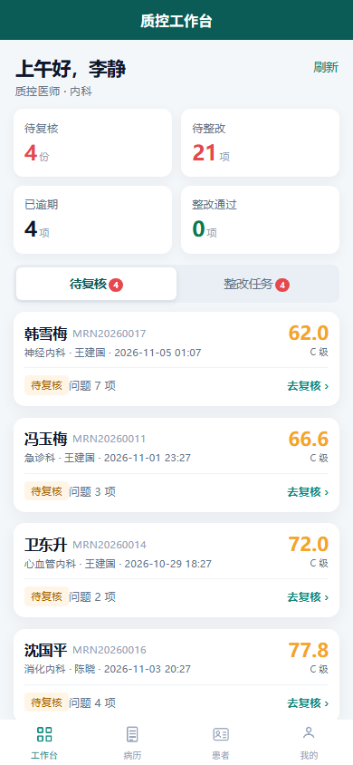

# 智医质控 MedAI · 微信小程序端

这是现有 Web 平台的 uni-app + Vue 3 小程序端，复用同一套 Node/MySQL 接口。



## 已实现页面

| 页面 | 路径 | 说明 |
| --- | --- | --- |
| 登录 | `pages/login/index` | 院内账号密码 + 微信一键登录/首次绑定 |
| 质控工作台 | `pages/workbench/index` | 待复核 / 整改任务 / 逾期统计 |
| 病历列表 | `pages/records/index` | 搜索、状态筛选、批量质控、下拉刷新、分页 |
| 病历详情 | `pages/record-detail/index` | 病历内容、AI 报告、人工复核/改判、整改提交/关闭 |
| 病历编辑 | `pages/record-edit/index` | 新建/编辑病历，保存草稿或保存并质控 |
| 患者管理 | `pages/patients/index` | 患者主索引、搜索、新增患者 |
| 患者详情 | `pages/patient-detail/index` | 患者信息、就诊记录、新建就诊、建病历 |
| 批量质控 | `pages/batch/index` | 批量任务进度轮询、逐份结果 |
| 质控历史/版本 | `pages/versions/index` | 质控时间线、版本对比、字段 diff |
| 质控报告 | `pages/report/index` | 原生报告页、分享；打印/PDF 走 Web 端 |
| 我的 | `pages/me/index` | 当前用户、角色、接口地址、退出登录 |

## 开发与构建

```bash
cd miniapp
npm install --registry=https://registry.npmmirror.com
npm run dev:mp-weixin      # 开发模式，产物 dist/dev/mp-weixin
npm run build:mp-weixin    # 生产构建，产物 dist/build/mp-weixin
npm run type-check         # 类型检查
```

## 在微信开发者工具中导入

1. 微信开发者工具（需**以管理员身份运行**）→ 项目列表 → **导入项目**
2. 目录选择：  
   `miniapp/dist/build/mp-weixin`
3. AppID：已配置真实 AppID `wx9e812ece6e5abdb5`；Secret 只放服务器 `.env`，不要写进小程序或 git
4. 打开项目后：右上角「详情」→「本地设置」→ 勾选  
   **不校验合法域名、web-view（业务域名）、TLS 版本以及 HTTPS 证书**
5. 登录账号：`quality / qc123456`（质控医师）或 `doctor / doc123456`（临床医师）

## 接口地址

`src/config.ts` 中默认指向已部署的 HTTPS 演示环境：

```ts
export const API_BASE = 'https://canola-kindness-scavenger.ngrok-free.dev';
```

本地联调可改为 `http://127.0.0.1:8801`，并在开发者工具关闭域名校验。

## 微信登录配置

已实现 `wx.login` → `/api/mp/login` → 首次绑定院内账号 → 后续一键登录。

服务端 `server/.env` 增加：

```ini
WECHAT_MP_APPID=你的小程序AppID
WECHAT_MP_SECRET=你的小程序Secret
```

未配置时接口返回 503，登录页自动提示并回退到院内账号密码登录。绑定接口：

- `POST /api/mp/login { code }` → 已绑定返回 JWT；未绑定返回 10 分钟 `bindToken`
- `POST /api/mp/login { bindToken, username, password }` → 校验院内账号并绑定 `users.wechat_openid`

## 尚未接入（正式上线前必须做）

1. **订阅消息**：整改任务待办/逾期提醒（需要小程序订阅消息模板 ID 和用户授权）。
2. **报告导出**：小程序不支持浏览器打印，需要原生报告页或服务端生成 PDF + `wx.openDocument`。
3. **正式域名**：`ngrok-free.dev` 只适合演示，正式小程序必须使用已备案 HTTPS 域名并加入 request 合法域名。
4. **合规**：医疗类目资质、隐私政策、患者数据脱敏、截图水印、等保与医院 UAT。

更完整的落地步骤见仓库根目录 [docs/医院落地.md](../docs/医院落地.md)。
